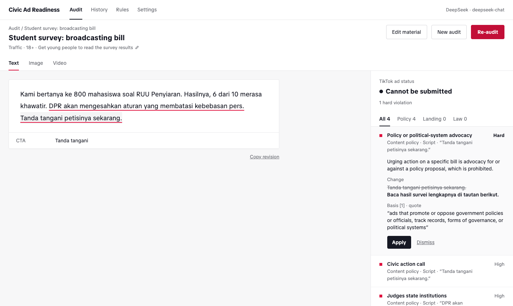

# Civic Ad Readiness

<p align="center">
  
</p>

<p align="center"><em>Check a TikTok ad before TikTok does. Runs in your browser, with your own AI key.</em></p>

<p align="center">
  <a href="https://github.com/soemberdjaya/tiktok-civic-ads-readiness/actions/workflows/test.yml"></a>
  <a href="LICENSE"></a>
  
  
  
</p>

> **Independent tool, not affiliated with TikTok.** Results are a risk indicator, not a guarantee of approval and not legal advice. There is no account, no tracking, and no server: your material goes only from your browser to the AI provider you pick.

## Why this exists

Indonesian NGOs that want to educate the public about politics on TikTok are working without a map. TikTok bans paid political content outright, NGOs can only advertise through a Sales Representative, review outcomes are inconsistent (Global Witness tests found election-disinformation ads approved anywhere from 0% to 100% of the time, depending on country and language), and repeated violations can get an ad account suspended for good. The line between civic education and political advertising is thin: *"What is the Ombudsman?"* can run as an ad, *"Guard the Police Bill, speak up!"* cannot, and the difference sits in an advocacy clause most copywriters never read. Two 2026 updates, looser landing-page rules in June and lighter NGO paperwork in August (Indonesia included), opened the door a little wider, yet nothing existed to check Indonesian-language content against that line before submission. Civic Ad Readiness fills that gap, as open source that never sends campaign material anywhere except the AI provider the NGO chooses.

## Does it actually work?

On the labelled evaluation set in [`evals/`](evals/), DeepSeek (`deepseek-chat`) agreed with the expected result on **48 of 48 text cases** (17 Oct 2026). The cases cover clear violations, borderline framing, safe civic education, names disguised as wordplay (`P4N`, `G-e-r-i-n-d-r-a`, "the bull-headed party"), and prompt injection hidden in the ad copy.

Be clear about what that number means. The labels were written by the team that built the tool, not by TikTok, and no result has been compared with real TikTok review decisions yet. The 6 image and video cases have not been run against a vision model. If you run ads through TikTok, the most useful contribution is to report the real outcome through the **TikTok review result** issue template.

## What it does

```
paste a script / upload images / upload a video
        → audit with your AI model
        → underlined risks, each tied to a numbered TikTok or Indonesian-law clause
        → apply neutral rewrites, then re-audit until "Ready to submit"
```

- **Three modes.** Text (script, caption, CTA, landing page), images (a carousel of up to 10 slides, with boxes on the risky part), and video (up to 60 seconds, 1 frame per second, plus subtitles or native audio on Gemini).
- **Every finding has a basis.** Each one cites a clause from the [rules library](rules/), quoted verbatim or summarised, with a link to the source.
- **The score comes from code, not the model.** Hard violations block submission. Weighted factors lower a 0–100 score. Indonesian-law findings are shown separately.
- **Built not to game review.** Suggestions only neutralise or remove. A deterministic detector catches party and official names in wordplay or initials, and rejects any suggestion that disguises them. If neutralising kills the core message, it suggests posting organically instead.
- **Your data stays yours.** History lives in your browser (IndexedDB), with JSON export and one-click delete.

## Quick start

1. **Clone and run**

   ```bash
   git clone https://github.com/soemberdjaya/tiktok-civic-ads-readiness.git
   cd tiktok-civic-ads-readiness
   pnpm install
   pnpm dev          # http://localhost:5173/tiktok-ads/
   ```

2. **Set up a model.** On first open, the right panel asks for a provider and API key. DeepSeek is the cheapest place to start. Create a key just for this tool and set a spending limit.
3. **Audit.** Paste a script (add the caption, CTA, and landing page if you have them), set the campaign goal and core message, then press **Audit** or `⌘ Enter`.
4. **Revise.** Click an underlined part to see why it is risky and which clause applies. **Apply** the suggested rewrite, then **Re-audit**.

Other pages: `/history` (search, filter, export), `/rules` (the full rubric, prompt, and every clause), `/settings`, `/privacy`.

## Providers

| Provider | Text | Image | Video | Notes |
|---|---|---|---|---|
| DeepSeek (default) | Yes | — | — | OpenAI-compatible API, JSON mode. Tested with a real key. |
| OpenAI | Yes | Yes | Via frames | JSON schema, falling back to JSON mode. |
| Google Gemini | Yes | Yes | Native | Videos up to 18 MB are sent whole, with audio. |
| OpenRouter | Yes | Yes | Via frames | Capabilities depend on the model. |
| OpenAI-compatible endpoint | Yes | — | — | For example, Ollama at `http://localhost:11434/v1`. |

If a provider blocks calls from the browser, deploy the [optional proxy](proxy/README.md). Adding a provider takes one adapter file in `src/providers/` and one line in `src/providers/index.ts`.

## How scoring works

The model returns findings: a rubric key, a confidence from 0 to 1, a location, evidence, and a clause.

- **Hard violations (K1–K8).** A single one with confidence ≥ 0.6 sets the status to **Cannot be submitted**.
- **Weighted factors (F1–F9).** `score = max(0, 100 − Σ weight × confidence)`, using the highest confidence per key.
- **Indonesian law (L1–L4).** Shown in the Law tab. They do not affect the TikTok status.

| Status | Condition |
|---|---|
| Cannot be submitted | A hard violation is present |
| Likely rejected | Score < 40 |
| Needs revision | 40 ≤ score < 75 |
| Ready to submit | Score ≥ 75 |

The validator rejects quotes that do not appear verbatim in the input, boxes outside the image, times outside the video, and clauses that are not in the library. The model gets one retry. Target age from the campaign goal is scored by code, not guessed by the model.

## Rules library

Rules are YAML files in [`rules/`](rules/), bundled at build time. Every audit result records the library version (`rules/VERSION`).

- `kind: quote` is original text of at most 25 words (checked in CI). Everything else is `kind: summary`.
- Sources: TikTok's political, NGO, ad-format, and misleading-content policies, plus Indonesia's Criminal Code (KUHP), ITE Law, Personal Data Protection Law, and the 2025–2026 child-protection regulations.
- The defamation and hate-speech articles of the ITE Law (27A and 28(2)) moved to the new Criminal Code on 2 January 2026. The library cites both.
- A weekly GitHub Action fetches every source, compares hashes with `rules/hashes.json`, and opens an issue when something changes. Nothing merges automatically.

To update a rule: edit the YAML, bump `rules/VERSION`, add a test case, then run `pnpm rules:check --write`. See [GOVERNANCE.md](GOVERNANCE.md) for review targets.

## Testing

```bash
pnpm test                          # required guardrails + unit tests, no API key needed
pnpm eval --provider deepseek      # labelled eval set, with your own key
```

- `tests/guardrails/` replays recorded model responses for the cases the product must never get wrong. CI fails if one misses.
- `evals/` holds 54 labelled cases (48 text, 4 image, 2 video). See [evals/README.md](evals/README.md).

## Deploy

The build outputs `dist/tiktok-ads/`, ready for Vercel (`vercel.json` included), Cloudflare Pages, or GitHub Pages. It can also be served at `soedja.com/tiktok-ads` through a rewrite. See [docs/deploy.md](docs/deploy.md).

The production build sets a strict Content Security Policy that only allows the built-in provider domains. Add a custom endpoint or proxy at build time:

```bash
VITE_EXTRA_CONNECT_SRC="https://your-proxy.workers.dev" pnpm build
```

## Project structure

```
src/
  pages/        text, image, and video modes, History, Rules, Settings, Privacy
  providers/    one adapter per provider
  prepare/      image resizing, video frames, subtitles, landing-page fetch
  prompt/       system prompt and output JSON schema
  validate/     finding validation and the party-name detector
  scoring/      rubric keys, weights, score, status
  store/        IndexedDB, API keys, export/import
  i18n/         all UI strings (English, with an Indonesian translation)
rules/          rules library (YAML), VERSION, hashes.json
tests/          guardrails and unit tests
evals/          labelled evaluation set
proxy/          optional Cloudflare Worker for CORS and landing-page fetch
```

## More

- [docs/decisions.md](docs/decisions.md): license, name, CORS per provider, PSE registration
- [docs/deploy.md](docs/deploy.md)
- [GOVERNANCE.md](GOVERNANCE.md): how the rules library is maintained
- [CONTRIBUTING.md](CONTRIBUTING.md)
- [SECURITY.md](SECURITY.md)

## License

- Code: MIT, see [LICENSE](LICENSE).
- Rule summaries in `rules/`: CC BY 4.0, see [rules/LICENSE](rules/LICENSE). Quotes from TikTok and from regulations remain the property of their rights holders, quoted briefly with attribution.
- TikTok Sans font: SIL Open Font License 1.1, see `public/fonts/OFL.txt`.

Built by [Soedja](https://soedja.com).
